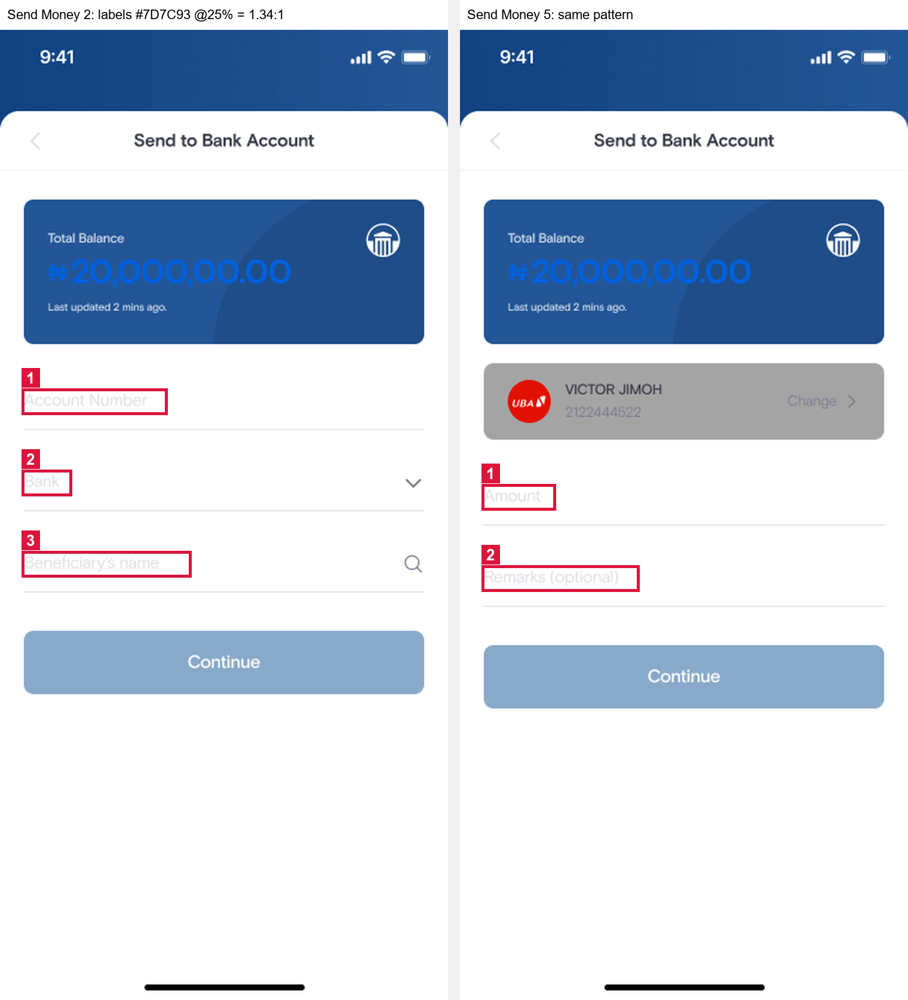
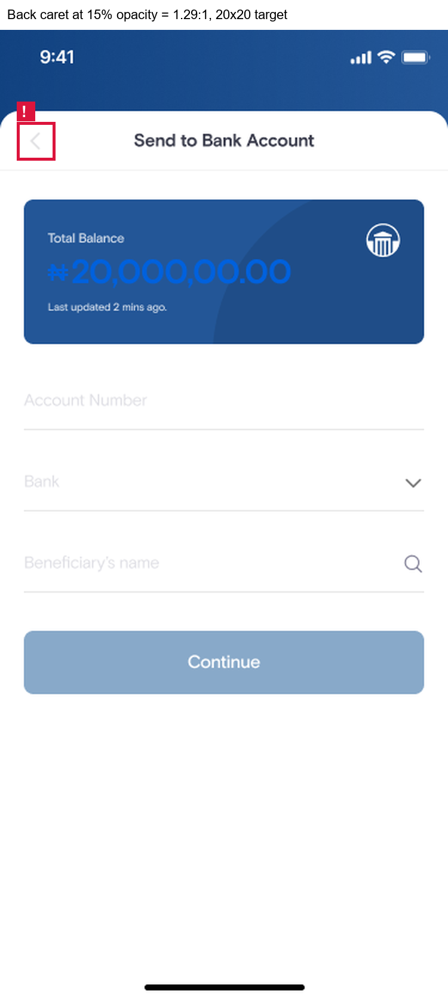
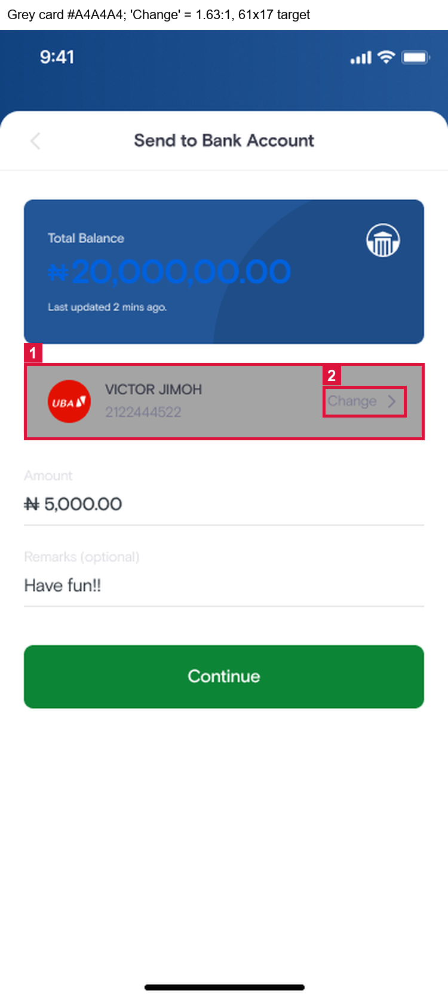
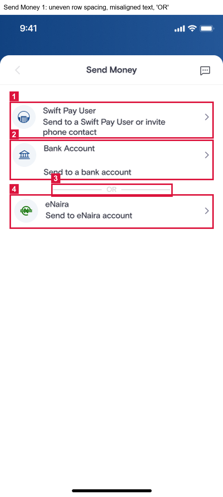
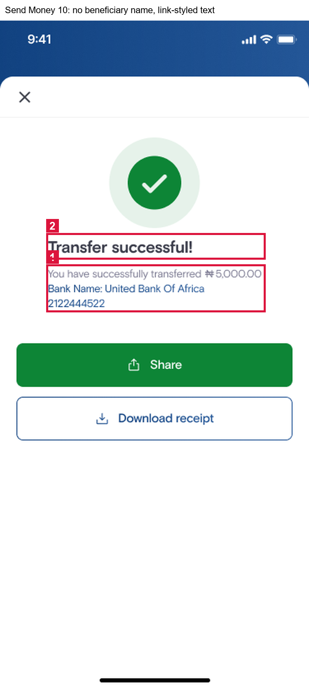
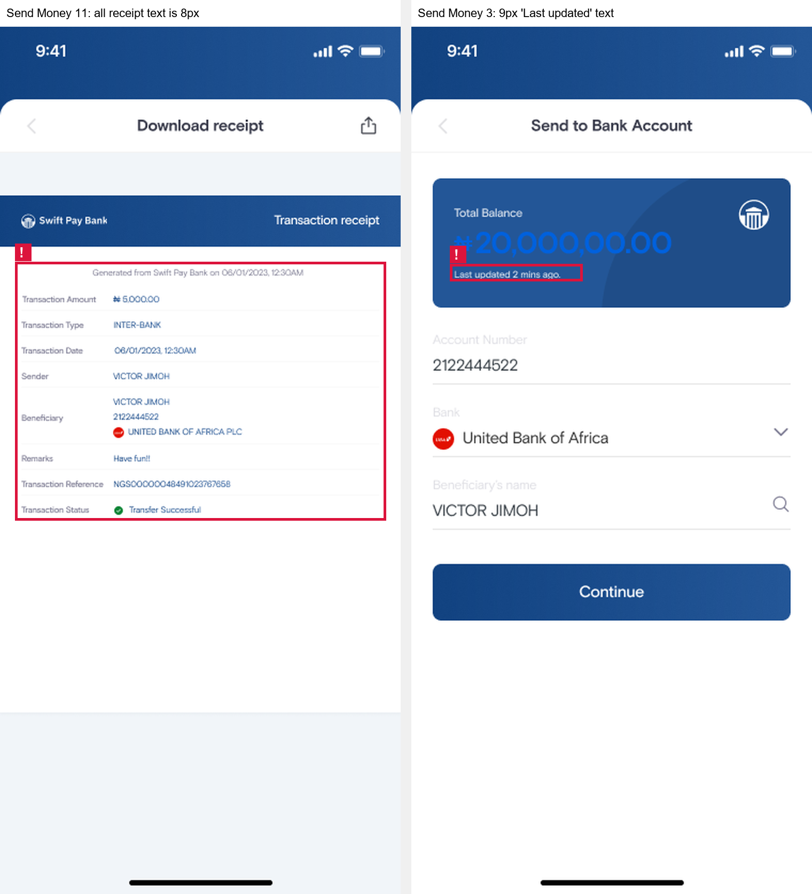
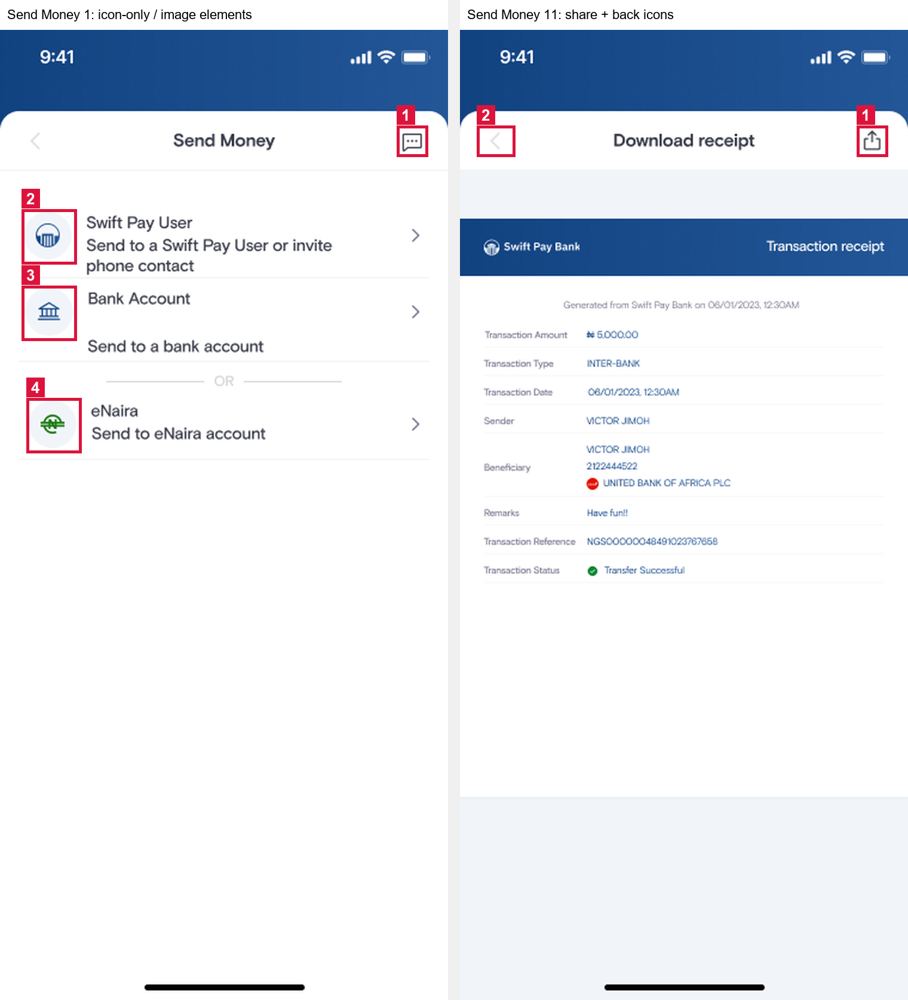
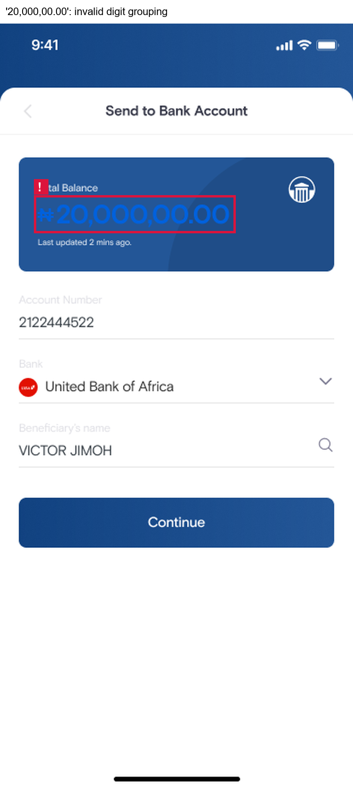
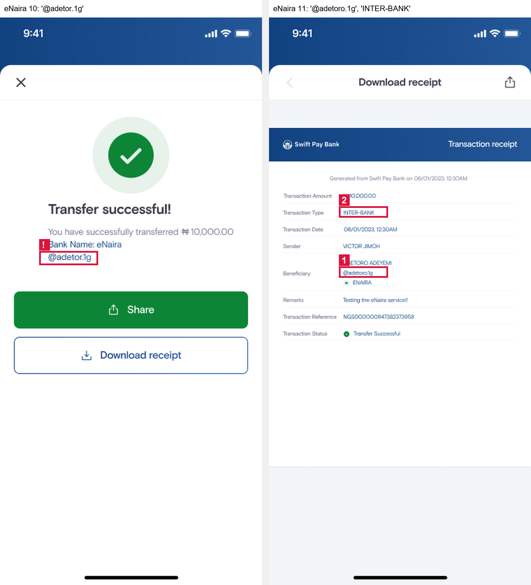

# Design Audit Report: SwiftPay "Send Money"

| | |
|---|---|
| **Auditor** | Josephus Mupanda |
| **Date** | 1 November 2026 |
| **Design file** | [SwiftPay Flaws (Figma)](https://www.figma.com/design/mqbdvfhSQRR35JHt4MVpPV/SwiftPay-Flaws?node-id=0-1) |
| **Standard** | WCAG 2.1 Level AA (plus WCAG 2.2 SC 2.5.8 for touch targets) |

---

## 1. Scope

The audit covers the **Send Money** flow as designed in Figma:

| Flow | Frames | What happens |
|---|---|---|
| Send Money – Bank Account | Send Money 1 – 11 | Choose method → enter account → enter amount → passcode → processing → success → receipt |
| Send Money – eNaira Account | eNaira Account 10 – 11 | Success and receipt screens, checked for consistency with the bank flow |

Raw exports of every audited frame are in [`screenshots/`](screenshots/). Annotated evidence for each issue is in [`evidence/`](evidence/).

## 2. Method

1. **Inspection in Figma.** Every text layer was inspected for font family, size, weight, fill colour and layer opacity. Every container and icon was inspected for fill, stroke, opacity, size and layer name. Positions are given in frame coordinates (frames are 375 × 812).
2. **Contrast.** Ratios use the WCAG 2.1 relative-luminance formula. When a layer has reduced opacity, its colour was first blended onto the background behind it, because that blended colour is what the user actually sees. Thresholds: **4.5:1** for normal text, **3:1** for large text (≥ 18.66 px bold or ≥ 24 px) and for icons or other UI components (SC 1.4.11).
3. **Heuristics.** UX findings are tied to Nielsen's 10 usability heuristics. UI findings are tied to consistency, visual hierarchy, spacing and alignment, and colour-palette principles from the module.
4. **Not flagged on purpose.** The light-blue *disabled* "Continue" buttons (Send Money 2 and 5) were not reported. WCAG 1.4.3 explicitly exempts inactive components.

---

## 3. Design Audit Report

| Issue # | Issue Description (What is the problem?) | Issue Type | Justification (Why is this a problem? Reference a module concept.) |
|---------|------------------------------------------|------------|---------------------------------------------------------------------|
| **1** | **The "Total Balance" amount is almost invisible.** On *Send Money 2–6*, the balance `₦20,000,00.00` is set in bright blue `#0061DD` (Bold 28 px) on the blue card `#235697`. The measured contrast is **1.32:1**, and only **1.51:1** on the darker circle of the card. | Accessibility | This fails **WCAG 2.1 SC 1.4.3 Contrast (Minimum)**. Even as large text, the balance needs **3:1** and it reaches less than half of that. Blue on blue has almost no luminance difference, so users with low vision, colour-vision deficiency, or a phone in bright sunlight cannot read **the most important number on the screen**: how much money they have before sending. It also breaks the **Perceivable** principle of POUR. Fix: use white `#FFFFFF` on the card (7.37:1). |
| **2** | **The primary "Continue" button changes colour within the same flow.** On *Send Money 3* the enabled "Continue" is the brand blue gradient (`#235697 → #114280`). On *Send Money 6*, the same button for the same action is **green `#0D8536`**. Green is also used for "Share" and the check mark on the success screen (*Send Money 10*). | UI | This breaks **UI consistency** and the **colour-palette rule** that one colour should always mean one thing. Users learn that "blue = primary action". When the same button turns green, the change carries no meaning, so it looks like a mistake or a different action. Green is also the success colour in this app, so a green "Continue" can suggest the payment is already done when the user still has to enter their passcode. This also goes against Nielsen's **Consistency and standards** heuristic. Fix: use one primary-button style (brand blue) for every "Continue", and keep green only for success feedback. |
| **3** | **There is no feedback while the transfer is processing.** After the 4-digit passcode is entered (*Send Money 8*), *Send Money 9* covers the screen with a 50 % dark overlay (`#01080F` at 50 %, layer "Loading Overlay"). The overlay has **no spinner, no progress indicator and no message**. The user just sees a greyed-out keypad. | UX | This violates Nielsen's heuristic #1, **Visibility of system status**: the system should always tell users what is going on. In a money transfer, a frozen-looking screen makes users unsure whether the payment went through. They may tap again, close the app, or retry, which risks **duplicate transfers** (also an **Error prevention** problem). It is also inconsistent with *Send Money 4*, where the button does show a spinner. Fix: add a spinner and a live message such as "Sending ₦5,000.00 to Victor Jimoh…", announced to screen readers. |
| **4** | **The form field labels are faded almost to white.** On *Send Money 2–6*, the labels "Account Number", "Bank", "Beneficiary's name", "Amount" and "Remarks (optional)" use `#7D7C93` with the **layer opacity set to 25 %**. On white, this renders as `#DEDEE4`, a contrast of **1.34:1**. On empty fields they double as placeholders, so the label is the only indication of what to type. | Accessibility | This fails **WCAG SC 1.4.3 Contrast (Minimum)** (4.5:1 needed for 12–14 px text). It also undermines **SC 3.3.2 Labels or Instructions**: a label that cannot be read is effectively no label. Users with low vision, or anyone outdoors, cannot tell which field is the account number and which is the beneficiary name. In a payment form, that leads to input errors. Fix: remove the 25 % opacity and use a darker grey such as `#6B6A80` (5.25:1) for persistent labels. |
| **5** | **The back button looks disabled and is hard to see.** On every screen that has it (*Send Money 1–9, 11*), the top-left back caret (`#3C3F49`) sits in a frame with **15 % opacity**. It renders as `#E2E2E4` on white, a contrast of **1.29:1**. Its touch target is only **20 × 20 px**. | Accessibility | Icons that carry meaning must reach **3:1** under **WCAG SC 1.4.11 Non-text Contrast**, and this one reaches 1.29:1. At 15 % opacity it looks like a *disabled* control, so users may believe they cannot go back and correct a mistake (Nielsen: **User control and freedom**). The 20 × 20 px target is also below the **24 × 24 px minimum of SC 2.5.8 Target Size** and the 44 × 44 pt touch-target guidance from Apple's Human Interface Guidelines, which makes it hard to tap for users with motor impairments. Fix: full-opacity `#3C3F49` icon (10.5:1) with a 44 × 44 px tap area. |
| **6** | **The selected beneficiary card is grey, low-contrast and has a tiny "Change" link.** On *Send Money 5–6*, the card showing "VICTOR JIMOH / 2122444522" has a mid-grey `#A4A4A4` background. The account number and the "Change" link are `#7D7C93` on that grey (**1.63:1**), and the name `#3B3D4B` reaches only **4.31:1** at 12 px. The "Change" tap area is **61 × 17 px**. | Accessibility | The account number and "Change" fail **SC 1.4.3** badly (4.5:1 needed). Even the name falls just short. The account number is the detail users must check to avoid sending money to the wrong person, so it should be the easiest thing to read. A flat mid-grey surface is also the conventional visual cue for a **disabled** component, so the card does not *afford* interaction even though "Change" is tappable. The 17 px-high target fails **SC 2.5.8 Target Size (Minimum)** (24 px). Fix: a white or light card (`#F1F5F9`) with dark text (`#3B3D4B`, 9.8:1), and a full-height "Change" button. |
| **7** | **The payment-method list on *Send Money 1* has uneven spacing, misaligned content and a misplaced "OR" divider.** The gap between title and subtitle is **2 px** for "Swift Pay User" and "eNaira", but **23 px** for "Bank Account" (title at y = 218, subtitle at y = 258). The text columns start at **x = 72, 73 and 76** and the icons at **x = 20, 21 and 24**, so nothing lines up. An "OR" divider appears only between the 2nd and 3rd option, in `#D5D5D5` (**1.47:1** on white). | UI | Consistent **spacing and alignment** (a shared grid and spacing scale) is a core UI principle. The **Gestalt principle of proximity** says items that are close together read as one group. The 23 px gap visually separates "Send to a bank account" from its own title, so the second row reads like two separate items. The 1–4 px left-edge drift makes the list look unfinished and harder to scan. The single "OR" implies eNaira is the alternative to the first two options, when all three are equal choices; the divider text is also unreadable (fails **SC 1.4.3**). Fix: one list-item component with fixed spacing, a shared left edge, and either an "OR" between every option or none. |
| **8** | **The success screen does not confirm *who* received the money, and its plain text is styled like links.** *Send Money 10* shows the amount, "Bank Name: United Bank Of Africa" and "2122444522", but **not the beneficiary name** ("VICTOR JIMOH"). The bank and account lines use the brand-blue gradient that the app uses for interactive elements (the "Download receipt" button), yet they are not tappable. The text block is left-aligned at x = 58, under a centred check icon. | UX | The confirmation step should support **recognition rather than recall** (Nielsen). Users recognise a payee by name, not by a 10-digit account number, so they cannot quickly confirm the money went to the right person. Making non-interactive text look like interactive text creates a **false affordance**: users tap it and nothing happens. The left-aligned text under a centred icon also breaks the screen's **visual hierarchy and alignment**. Fix: "You sent ₦5,000.00 to **Victor Jimoh** (UBA • 2122444522)", centred, in body-text colour. |
| **9** | **The receipt and card text is too small to read.** On *Send Money 11* every line of the receipt (labels, values, reference, "Generated from…") is **8 px**. Labels are `#7D7C93` on white (**4.06:1**). On the balance card, "Last updated 2 mins ago." is **9 px**. | Accessibility | **Typography** guidance from the module calls for a readable minimum body size: Apple's Human Interface Guidelines set 11 pt as the smallest legible text, and 16 px is the common mobile body size. At 8 px, the transaction reference and amount, the details a user may need for a dispute, are unreadable for most users without zooming. At that size the labels also fail **SC 1.4.3** (4.06:1 < 4.5:1). If the receipt is generated as an image, users cannot enlarge the text with system font settings, which works against **SC 1.4.4 Resize Text**. Fix: at least 12–14 px on the receipt, labels `#6B6A80` (5.25:1), and a text-based (not image) receipt. |
| **10** | **Icon-only buttons and images have no accessible names, and one icon's meaning is unclear.** The header controls are bare icons: back (`CaretLeft`), close (`X`), share (`Export`) and a **speech-bubble icon (`ChatDots`) on *Send Money 1* with no label**. The bank logos are layers with auto-generated names (`31a86295-f41b-…`, `f83ba6f8-060e-…`), and the eNaira logo is a raster image named `e-naira-logo 2`. The file contains **no accessibility annotations** (alt text or button labels) for any of them. | Accessibility | **WCAG SC 1.1.1 Non-text Content** requires a text alternative for meaningful images. **SC 4.1.2 Name, Role, Value** requires every control to have an accessible name. With "Shift Left", developers build what the design specifies. Without annotations, a screen reader will announce "button, unlabelled" or read a file name such as "e-naira-logo 2", so blind users cannot tell back from close or share. The `ChatDots` icon is ambiguous even for sighted users (chat? support? messages?), which goes against Nielsen's **Recognition rather than recall**. Fix: annotate accessible names ("Back", "Close", "Share receipt", "Contact support", "United Bank for Africa logo") and add a visible label or tooltip to the chat icon. |
| **11** | **The balance is formatted incorrectly: `₦20,000,00.00`.** On *Send Money 2–6* and the eNaira screens, the digits are grouped as 2-3-2. Standard thousands grouping gives either `₦20,000,000.00` or `₦2,000,000.00`, so the actual amount is ambiguous. | UX | Nielsen's **Match between the system and the real world** says the interface should follow real-world conventions, and in finance the convention is strict 3-digit grouping. A balance that cannot be read with confidence breaks **user trust**, the most important quality of a payment app. The user also cannot judge whether they can afford the transfer, which weakens **error prevention**. Fix: format currency with a locale-aware formatter (`en-NG`, thousands separator every 3 digits). |
| **12** | **The eNaira flow shows conflicting payee and transaction details.** The beneficiary's wallet alias is **`@adetor.1g`** on the confirmation and success screens (*eNaira 2, 4, 5, 10*) but **`@adetoro.1g`** on the receipt (*eNaira 11*). The receipt also labels this wallet transfer **"INTER-BANK"**, and the success screen says **"Bank Name: eNaira"**, although eNaira is a digital-currency wallet, not a bank. | UX | **Consistency and standards** (Nielsen) and **trust** require the same information to appear the same way at every step. If the alias changes between confirmation and receipt, the user cannot tell which account actually received the money, and a dispute becomes harder (also an **Error prevention** concern). Reusing bank-transfer wording for an eNaira transfer breaks **Match between the system and the real world**: the labels describe the wrong kind of transaction. Fix: render all payee details from one source, and use eNaira-specific labels ("Wallet: eNaira", type "eNaira transfer"). |

---

## 4. Evidence

### Issue 1 – Balance contrast

### Issue 2 – Inconsistent primary button colour

### Issue 3 – Processing state without feedback

### Issue 4 – Faded form labels

### Issue 5 – Back button at 15 % opacity

### Issue 6 – Grey beneficiary card

### Issue 7 – Payment-method list layout

### Issue 8 – Success screen

### Issue 9 – Text too small on the receipt

### Issue 10 – Unlabelled icons and images

### Issue 11 – Balance format

### Issue 12 – Conflicting eNaira details

---

## Appendix A – Contrast measurements

| Element | Screen(s) | Foreground (as seen) | Background | Ratio | Required | Result |
|---|---|---|---|---|---|---|
| Balance amount (Bold 28 px) | Send Money 2–6 | `#0061DD` | `#235697` | **1.32:1** | 3:1 | ❌ Fail |
| Balance amount, darker card area | Send Money 2–6 | `#0061DD` | `#204D88` | **1.51:1** | 3:1 | ❌ Fail |
| Field labels (`#7D7C93` @ 25 %) | Send Money 2–6 | `#DEDEE4` | `#FFFFFF` | **1.34:1** | 4.5:1 | ❌ Fail |
| Back caret (`#3C3F49` @ 15 %) | Send Money 1–9, 11 | `#E2E2E4` | `#FFFFFF` | **1.29:1** | 3:1 | ❌ Fail |
| Account number / "Change" | Send Money 5–6 | `#7D7C93` | `#A4A4A4` | **1.63:1** | 4.5:1 | ❌ Fail |
| Beneficiary name (12 px) | Send Money 5–6 | `#3B3D4B` | `#A4A4A4` | **4.31:1** | 4.5:1 | ❌ Fail |
| "OR" divider text (12 px) | Send Money 1 | `#D5D5D5` | `#FFFFFF` | **1.47:1** | 4.5:1 | ❌ Fail |
| Receipt labels (8 px) | Send Money 11 | `#7D7C93` | `#FFFFFF` | **4.06:1** | 4.5:1 | ❌ Fail |
| Primary button text, green variant | Send Money 6 | `#FFFFFF` | `#0D8536` | 4.75:1 | 4.5:1 | ✅ Pass (issue 2 is about consistency, not contrast) |
