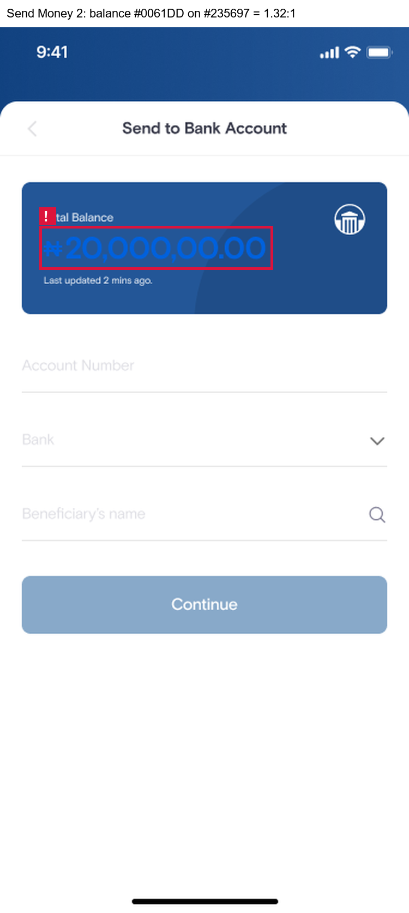
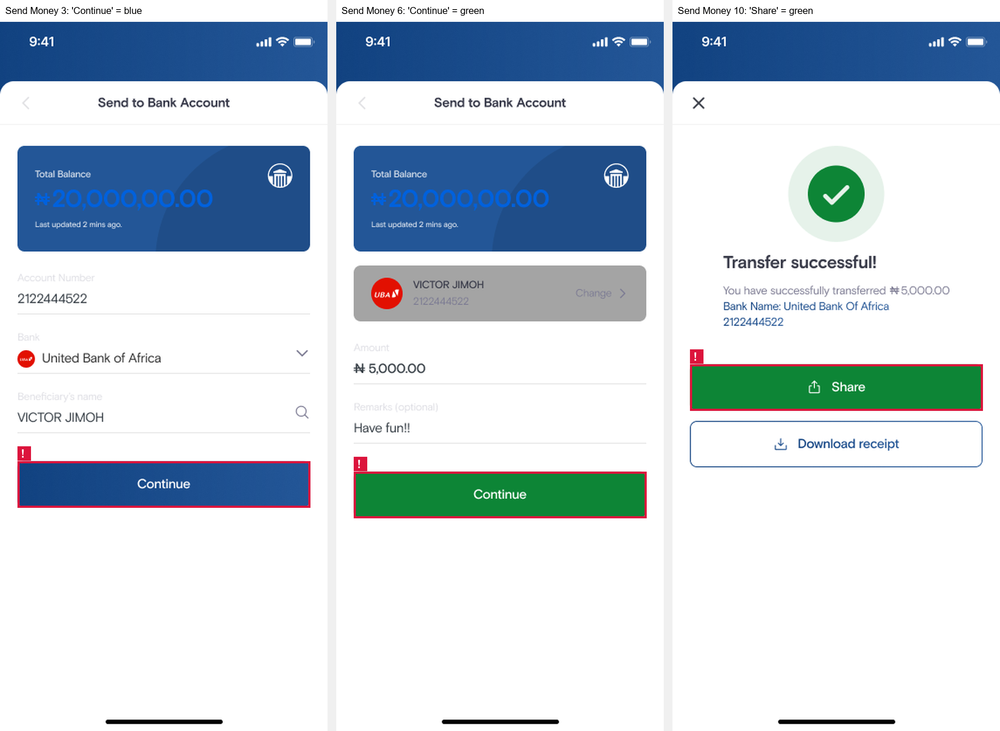
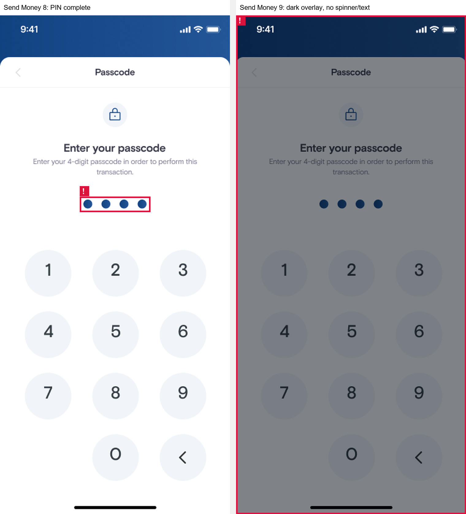

# Design Audit Report: SwiftPay "Send Money"

| | |
|---|---|
| **Auditor** | Josephus Mupanda |
| **Date** | 1 November 2026 |
| **Design file** | [SwiftPay Flaws (Figma)](https://www.figma.com/design/mqbdvfhSQRR35JHt4MVpPV/SwiftPay-Flaws?node-id=0-1) |
| **Standard** | WCAG 2.1 Level AA (plus WCAG 2.2 SC 2.5.8 for touch targets) |

---

## 1. Scope

The audit covers the **Send Money** flow as designed in Figma:

| Flow | Frames | What happens |
|---|---|---|
| Send Money – Bank Account | Send Money 1 – 11 | Choose method → enter account → enter amount → passcode → processing → success → receipt |
| Send Money – eNaira Account | eNaira Account 10 – 11 | Success and receipt screens, checked for consistency with the bank flow |

Raw exports of every audited frame are in [`screenshots/`](screenshots/). Annotated evidence for each issue is in [`evidence/`](evidence/).

## 2. Method

1. **Inspection in Figma.** Every text layer was inspected for font family, size, weight, fill colour and layer opacity. Every container and icon was inspected for fill, stroke, opacity, size and layer name. Positions are given in frame coordinates (frames are 375 × 812).
2. **Contrast.** Ratios use the WCAG 2.1 relative-luminance formula. When a layer has reduced opacity, its colour was first blended onto the background behind it, because that blended colour is what the user actually sees. Thresholds: **4.5:1** for normal text, **3:1** for large text (≥ 18.66 px bold or ≥ 24 px) and for icons or other UI components (SC 1.4.11).
3. **Heuristics.** UX findings are tied to Nielsen's 10 usability heuristics. UI findings are tied to consistency, visual hierarchy, spacing and alignment, and colour-palette principles from the module.
4. **Not flagged on purpose.** The light-blue *disabled* "Continue" buttons (Send Money 2 and 5) were not reported. WCAG 1.4.3 explicitly exempts inactive components.

---

## 3. Design Audit Report

| Issue # | Issue Description (What is the problem?) | Issue Type | Justification (Why is this a problem? Reference a module concept.) |
|---------|------------------------------------------|------------|---------------------------------------------------------------------|
| **1** | **The "Total Balance" amount is almost invisible.** On *Send Money 2–6*, the balance `₦20,000,00.00` is set in bright blue `#0061DD` (Bold 28 px) on the blue card `#235697`. The measured contrast is **1.32:1**, and only **1.51:1** on the darker circle of the card. | Accessibility | This fails **WCAG 2.1 SC 1.4.3 Contrast (Minimum)**. Even as large text, the balance needs **3:1** and it reaches less than half of that. Blue on blue has almost no luminance difference, so users with low vision, colour-vision deficiency, or a phone in bright sunlight cannot read **the most important number on the screen**: how much money they have before sending. It also breaks the **Perceivable** principle of POUR. Fix: use white `#FFFFFF` on the card (7.37:1). |
| **2** | **The primary "Continue" button changes colour within the same flow.** On *Send Money 3* the enabled "Continue" is the brand blue gradient (`#235697 → #114280`). On *Send Money 6*, the same button for the same action is **green `#0D8536`**. Green is also used for "Share" and the check mark on the success screen (*Send Money 10*). | UI | This breaks **UI consistency** and the **colour-palette rule** that one colour should always mean one thing. Users learn that "blue = primary action". When the same button turns green, the change carries no meaning, so it looks like a mistake or a different action. Green is also the success colour in this app, so a green "Continue" can suggest the payment is already done when the user still has to enter their passcode. This also goes against Nielsen's **Consistency and standards** heuristic. Fix: use one primary-button style (brand blue) for every "Continue", and keep green only for success feedback. |
| **3** | **There is no feedback while the transfer is processing.** After the 4-digit passcode is entered (*Send Money 8*), *Send Money 9* covers the screen with a 50 % dark overlay (`#01080F` at 50 %, layer "Loading Overlay"). The overlay has **no spinner, no progress indicator and no message**. The user just sees a greyed-out keypad. | UX | This violates Nielsen's heuristic #1, **Visibility of system status**: the system should always tell users what is going on. In a money transfer, a frozen-looking screen makes users unsure whether the payment went through. They may tap again, close the app, or retry, which risks **duplicate transfers** (also an **Error prevention** problem). It is also inconsistent with *Send Money 4*, where the button does show a spinner. Fix: add a spinner and a live message such as "Sending ₦5,000.00 to Victor Jimoh…", announced to screen readers. |

---

## 4. Evidence

### Issue 1 – Balance contrast

### Issue 2 – Inconsistent primary button colour

### Issue 3 – Processing state without feedback

---

## Appendix A – Contrast measurements

| Element | Screen(s) | Foreground (as seen) | Background | Ratio | Required | Result |
|---|---|---|---|---|---|---|
| Balance amount (Bold 28 px) | Send Money 2–6 | `#0061DD` | `#235697` | **1.32:1** | 3:1 | ❌ Fail |
| Balance amount, darker card area | Send Money 2–6 | `#0061DD` | `#204D88` | **1.51:1** | 3:1 | ❌ Fail |
| Primary button text, green variant | Send Money 6 | `#FFFFFF` | `#0D8536` | 4.75:1 | 4.5:1 | ✅ Pass (issue 2 is about consistency, not contrast) |
